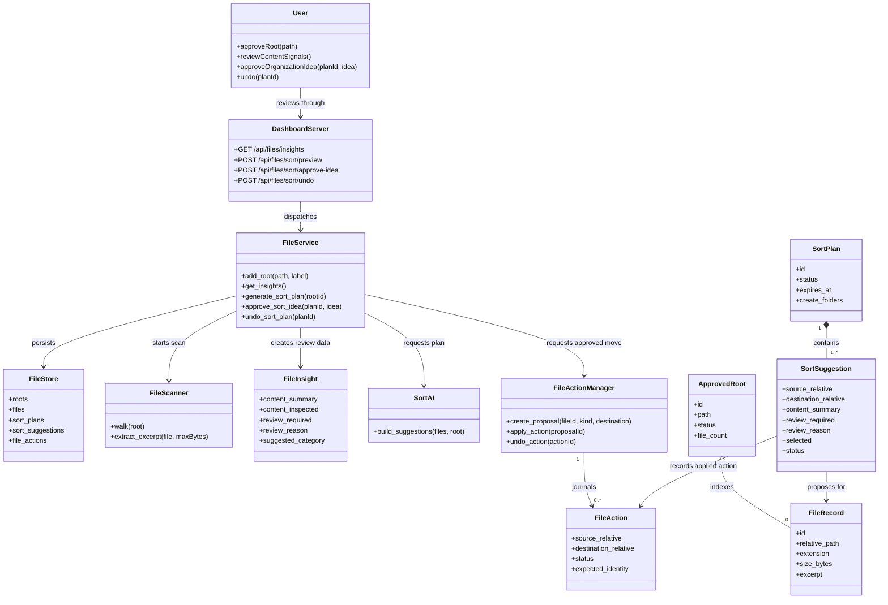

# UML model

This model describes the approved File Intelligence flow. It uses the standard
UML ideas from the referenced class-diagram and use-case lectures: classes own
data and operations, associations show collaboration, and the user must
explicitly approve every filesystem mutation.

## Class diagram

## Use-case diagram

## Content-review boundary

The `Inspect` use case reads at most 4 KiB from approved, non-sensitive text
extensions. It can describe likely source code, tabular data, documentation,
logs, empty files, placeholder names, draft markers, and generated artifacts.
Binary and media files are classified from metadata only. A `Review` result is
an explanation for the user, never an automatic delete or move command.
