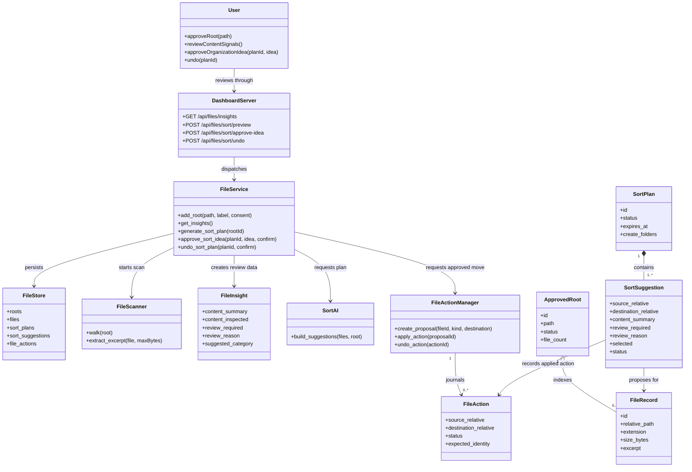
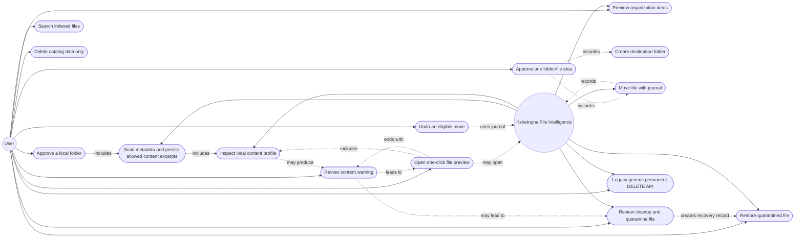
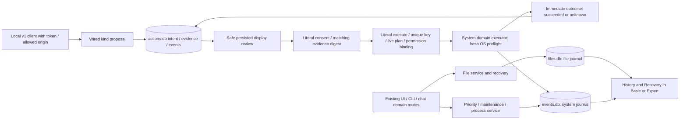

# UML model

The first diagrams describe the **0.5.0 File Intelligence domain**. The last
diagram shows the implemented narrow canonical action rollout at `25a0de7`,
alongside domain-authoritative compatibility routes, not universal v1 coverage.
The [final contract](FINAL_RELEASE.md) remains authoritative and 1.0.0 is gated.

Service execution/undo now requires literal confirmation; new root approval
requires explicit consent even through path-based CLI/JSONL previews. UI
Basic/Expert mode changes visibility only, not those permissions. The canonical
ledger is implemented for four system kinds, while file kinds remain deferred
and existing domain journals remain authoritative. See [the action contract](ACTIONS.md).

## Current file-domain class diagram

## Current file-domain use cases

## Content-review boundary

The current scan persists excerpts as well as metadata; it is **not metadata-only
by default**. Plain-text input and Office text output are bounded to 4,096 bytes
(Office also has a separate XML-read budget). PDF input/decompression are bounded
separately and final output is at most **4,096 characters**, not guaranteed 4 KiB.
Office extraction is inert text extraction, not macro execution. Approved images
and PDFs may also be rendered locally; unsupported binaries use metadata. No
semantic image vision or OCR is claimed. Known sensitive files get no excerpt,
but exclusion lists are not a complete secret detector. See [privacy](PRIVACY.md).

The evidence can describe likely source, data, notes, logs or generated files;
it is not certainty or authorization. Quarantine removes an original path while
retaining the bytes, normally on the same volume; it does not recover capacity.
The reviewed cleanup flow has no final purge. Legacy permanent DELETE is a
separate compatibility API with a default-off service danger permission and
generation-bound proposal; its UI is visible only in Expert, not authorized by
Expert. Restore/undo remain available in both modes with domain safety checks.

## Current narrow canonical lifecycle and domain coexistence

Wired v1 kinds are **memory trim, process close, process termination and fixed
external tools only**. Capabilities return `canonical_authority_complete:false`;
file/priority/temp-cleanup/model-unload adapters are deferred. Persisted review
is display-only; missing/malformed/legacy/erased evidence is unavailable and
cannot reconstruct execution. Exact-name termination uses the returned typed
confirmation value. Relevant permission off/on invalidates pending approvals.

The ledger does not turn three databases into one atomic transaction. Startup
revokes unused approvals and fences interrupted claims as unknown/recovery-
required, never blindly replaying. Domain journals decide actual recovery and
display pagination cannot limit that discovery. Audit events are not tamper-proof
against the same Windows user. Close/tool launch is not confirmed completion.

Basic is the safe normal default; Expert changes visibility, not permissions.
Telemetry, root access, maintenance, app controls and local AI have distinct
consent. **Separate content inspection/metadata-only default remains pending**:
approved scans still persist excerpts. Old-excerpt migration/erasure,
comprehensive log/export redaction and delayed action measurements remain gates.
Nullable commit/cache/low-memory/disk health exists but is not delayed outcome
verification. Telemetry deletion is not canonical history erasure; selected
canonical erasure preserves unresolved recovery and audit/replay tombstones.
Untrusted filenames, documents and model replies never authorize arbitrary
execution. No standby purge, registry cleaner or automatic process termination
is introduced by this lifecycle.

Final gates include native pinned-runtime x64/ARM64 race/crash tests, accessible
UI, exact signed artifacts and declared-hardware/user qualification; see
[feature matrix](FEATURE_MATRIX.md) and [recorded validation](VALIDATION.md).
